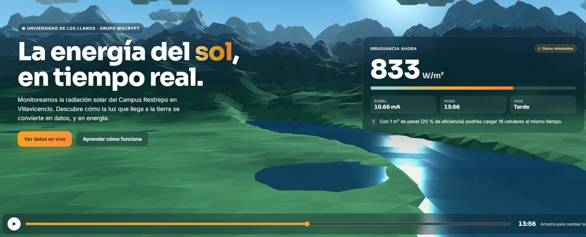
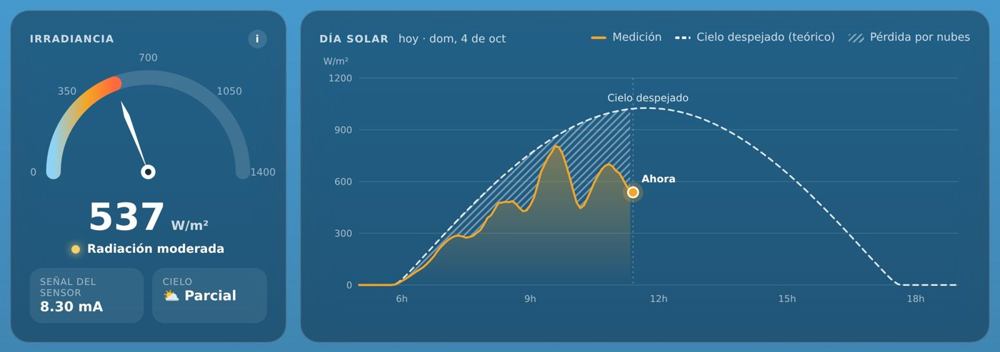
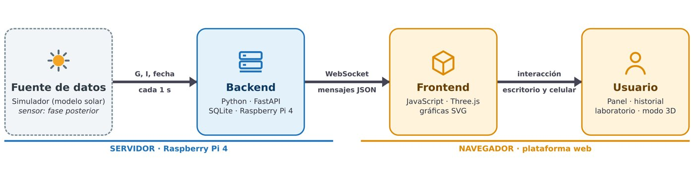
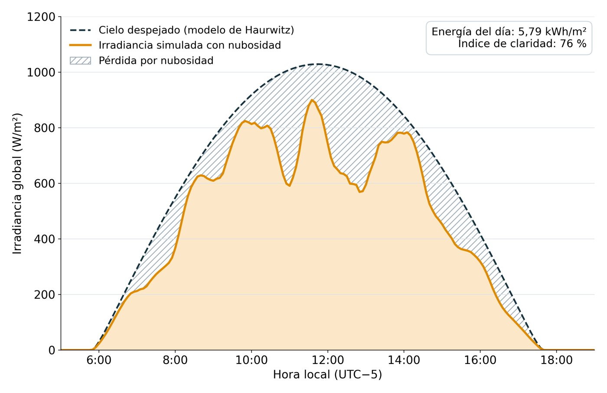
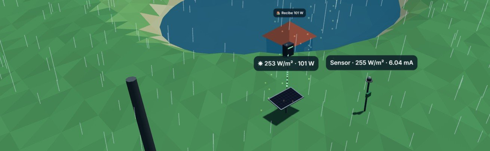

# Observatorio Solar · Campus Restrepo

Plataforma web interactiva que muestra en tiempo real la radiación solar del Campus Restrepo de la Universidad de los Llanos y la convierte en una herramienta educativa para estudiantes y comunidad.

**🔗 Ver en vivo:** [https://juanbuitrago.github.io/radiacion-solar](https://juanbuitrago-ing.github.io/Radiacion-Solar/)

Proyecto de grado en la modalidad de proyección social (EPPS), Universidad de los Llanos, 2026. Presentado como póster en el **VI Congreso Internacional de Ciencias Básicas e Ingeniería (CICI 2026)**, Villavicencio.

## El problema

Los datos de radiación solar suelen mostrarse como tablas o gráficas técnicas que la comunidad no entiende. Además, mientras se instala el sensor no hay mediciones para construir y probar la interfaz.

## Qué hace la plataforma

| Módulo | Qué permite |
| --- | --- |
| Paisaje 3D | Escena del piedemonte donde el cielo cambia con la hora |
| Panel en vivo | Velocímetro de irradiancia, curva del día e indicadores |
| Historial | Últimos 7 días, calendario de calor y descarga en CSV |
| Laboratorio | 12 experimentos guiados (nubes, humo, suciedad, sombras, fallas del sensor) y modo libre |
| Modo estudio | Instalación solar en 3D con sombras, lluvia y flujo de energía |
| Recorrido del dato | Animación de 8 etapas, del sol a la pantalla |
| Configuración | Calibración, tarifa y umbrales |

## Cómo funciona

- **Simulador físico:** reproduce el sol de Villavicencio (4,14° N) con las ecuaciones de posición solar de la NOAA, el modelo de cielo despejado de Haurwitz y el efecto de la nubosidad (Kasten–Czeplak). Permitió construir y probar toda la interfaz antes de tener mediciones reales.
- **Comunicación en tiempo real:** mensajes JSON por WebSocket, con el mismo formato que enviará la Raspberry Pi 4 con el sensor. Pasar del simulador al sensor real no requiere cambios en la interfaz.
- **Un solo archivo:** HTML autocontenido de unos 170 kB, sin más dependencias que Three.js, y adaptable a celular.

*Día simulado (1 de octubre): 5,79 kWh/m² frente a 7,62 kWh/m² con cielo despejado, índice de claridad del 76 % y pico de 900 W/m² a las 11:35.*

## Tecnologías

JavaScript · Three.js (WebGL) · SVG · HTML/CSS · WebSocket · JSON · Raspberry Pi 4

## Equipo

- **Juan Camilo Céspedes Buitrago**: diseño y desarrollo de la plataforma web, el simulador y el póster.
- **Ing. Omar Yesid Beltrán Gutiérrez**: director del proyecto.
- **Ing. Javier Eduardo Martínez Baquero**: codirector del proyecto.

Grupo de investigación MACRYPT · Facultad de Ciencias Básicas e Ingeniería · Universidad de los Llanos.
